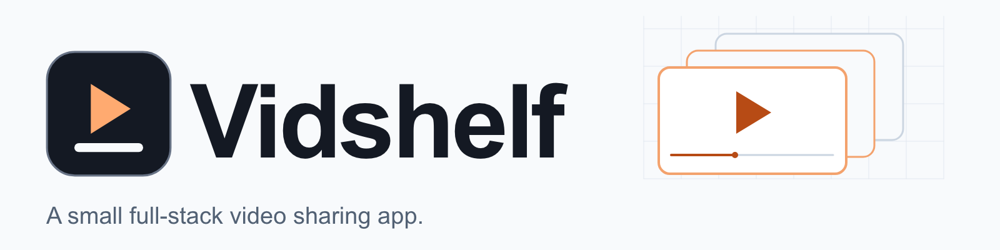
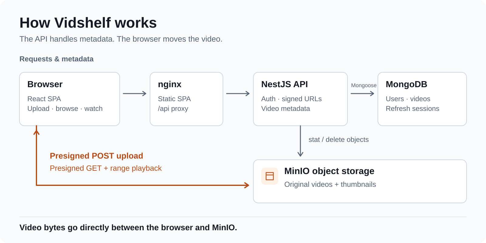
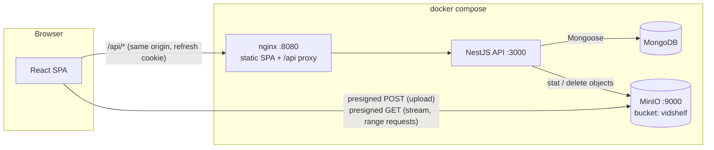
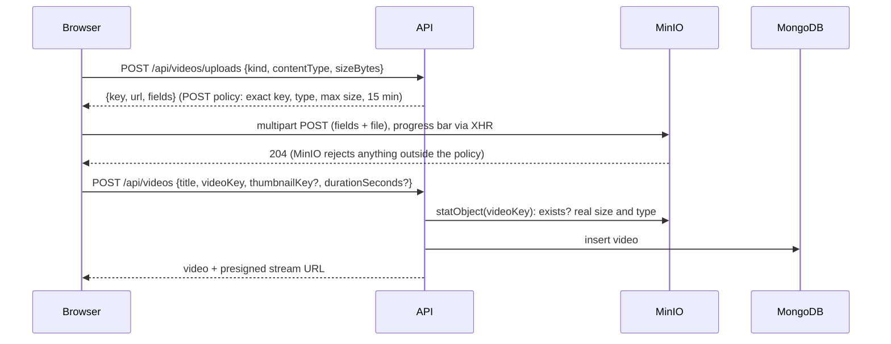

<div align="center">

<picture>
  <source media="(prefers-color-scheme: dark)" srcset="docs/assets/banner-dark.png">
  <source media="(prefers-color-scheme: light)" srcset="docs/assets/banner-light.png">
  
</picture>

### Upload straight to object storage. Stream straight back.

[](https://github.com/lemun/vidshelf/actions/workflows/ci.yml)
[](.nvmrc)
[](LICENSE)

[Quick start](#quick-start) · [How it works](#how-it-works) · [Features](#features) · [API](#api) · [Tests](#tests) · [Limits](#what-is-not-done)

</div>

A small full-stack video sharing app. You can sign up, upload a video straight to object storage,
browse and search, watch it stream, and like it.

The scope is deliberately small: every feature listed here is wired end to end, and
[What is not done](#what-is-not-done) lists what is missing.

<p align="center">
  
  <br>
  <sub>The home page from the running compose stack, with sample videos (not a mockup).</sub>
</p>

## Why Vidshelf

- **Video bytes never touch the API.** The API signs short-lived URLs; the browser uploads to and
  streams from MinIO directly, so the Node process never holds a video in memory.
- **Storage enforces the rules.** Uploads use a presigned POST policy, so MinIO itself rejects
  any file outside the signed key, content type or size range.
- **Auth that notices theft.** Access and refresh JWTs where each refresh token works once, and
  replaying a used one revokes the user's sessions.
- **One command to run.** A single `docker compose` file starts MongoDB, MinIO, the API and the
  web app behind nginx. There are no built-in secrets.

## Quick start

Requires Docker with Compose v2. For local development you also need Node.js 24 LTS (`.nvmrc`).

```bash
git clone https://github.com/lemun/vidshelf.git
cd vidshelf
scripts/gen-env.sh        # writes .env with random JWT secrets and MinIO credentials
docker compose up --build # builds and starts everything
```

Open http://localhost:8080, sign up, and upload a video. Details, other addresses and hot-reload
development are in [Run it](#run-it).

## Features

- **Accounts:** sign up, sign in and sign out; 15-minute access JWT in memory, 7-day refresh token
  in an `httpOnly`, `SameSite=Strict` cookie, rate-limited auth routes.
- **Direct uploads:** presigned POST policy per file, a progress bar, and a poster frame and
  duration captured in the browser.
- **Streaming:** presigned GET URLs, so `<video>` seeks with plain HTTP range requests to MinIO.
- **Browse and search:** newest-first list and MongoDB full-text search.
- **Likes and views:** atomic, idempotent likes; play counts.
- **Owner controls:** edit title and description, delete a video and its stored files.
- **Stack:** NestJS 12, MongoDB (Mongoose 9), MinIO (S3-compatible) and Swagger on the API;
  React 19, React Router 8, Vite 8 and Tailwind CSS 4 on the web.

<p align="center">
  
  
  <br>
  <sub>Watch page and upload page. Taken by Playwright from the running compose stack. To regenerate:
  <code>docker compose up --build -d &amp;&amp; SCREENSHOTS=1 npx playwright test screenshots</code>.</sub>
</p>

## How it works

<p align="center">
  <picture>
    <source media="(prefers-color-scheme: dark)" srcset="docs/assets/how-it-works-dark.svg">
    
  </picture>
</p>



Video bytes never pass through the API or nginx. The API decides who may write which object and
signs short-lived URLs. The browser then talks to MinIO directly.



### Design notes

- **Uploads use a presigned POST policy, not an API proxy.** A proxy would hold every upload in
  the Node process and double the traffic. A presigned PUT cannot cap the file size. A POST policy
  lets MinIO enforce the exact key, content type and size range, so the API only signs and then
  verifies with `statObject`. The size and type stored for a video come from storage, never from
  the client. Keys look like `videos/<userId>/<uuid>.<ext>`, and `POST /videos` rejects a key
  outside the caller's own prefix.
- **There are two MinIO clients.** S3 signatures cover the Host header. The API reaches MinIO as
  `minio:9000` inside compose, but the browser needs URLs for `localhost:9000`. One client does
  the real calls on the internal address. The second only signs for `MINIO_PUBLIC_URL`, and since
  its region is fixed, signing never opens a network connection.
- **Streaming uses a presigned GET URL** that is valid for one hour. `<video>` makes its own HTTP
  range requests to MinIO, so seeking works without any streaming code in the API.
- **Auth.** A 15-minute access JWT held in memory by the web app, plus a 7-day refresh token in an
  `httpOnly`, `SameSite=Strict` cookie. Each refresh token works exactly once, and replaying a used one
  revokes the user's sessions. A short grace window covers two tabs refreshing at the same time. Routes
  require a token unless marked `@Public()`, and `/api/auth/*` is rate limited per IP. The full design,
  including the races it handles, is in [docs/auth.md](docs/auth.md).
- **Likes are atomic and idempotent.** Each like is one single-document update with a filter
  (`likedBy: {$ne: me}` with `$addToSet` and `$inc`), so double clicks and retries cannot skew the
  count.
- **Validation and errors.** DTOs use `class-validator`, unknown fields are rejected, and ids are
  checked before they reach a query. Passwords are limited to 72 bytes of UTF-8, not 72
  characters, because bcrypt ignores everything after byte 72; the bcrypt cost is 12 by default
  and the API refuses to start with less than 10. MongoDB duplicate keys map to 409. The environment is
  validated once at startup, and the API refuses to start with a list of everything that is wrong.
- **Thumbnails and duration are captured in the browser.** The upload page draws a frame onto a
  canvas, so the server needs no ffmpeg.

## API

Swagger UI is served at `/api/docs` (http://localhost:3000/api/docs when running).

| Method       | Path                                 | Auth              | Purpose                                                                |
| ------------ | ------------------------------------ | ----------------- | ---------------------------------------------------------------------- |
| POST         | `/api/auth/register`                 | public            | Create an account. Returns an access token and sets the refresh cookie |
| POST         | `/api/auth/login`                    | public            | Sign in                                                                |
| POST         | `/api/auth/refresh`                  | refresh cookie    | Rotate the refresh token. Returns a new access token                   |
| POST         | `/api/auth/logout`                   | refresh cookie    | Revoke the current refresh token and clear the cookie                  |
| GET          | `/api/auth/me`                       | bearer            | The signed-in user                                                     |
| POST         | `/api/videos/uploads`                | bearer            | Presigned POST policy for a video or thumbnail                         |
| POST         | `/api/videos`                        | bearer            | Publish an uploaded video                                              |
| GET          | `/api/videos?q=&owner=&page=&limit=` | public            | List newest first, or full-text search                                 |
| GET          | `/api/videos/:id`                    | public            | One video with a presigned stream URL and `likedByMe`                  |
| PATCH        | `/api/videos/:id`                    | bearer (uploader) | Edit title or description                                              |
| DELETE       | `/api/videos/:id`                    | bearer (uploader) | Delete the record and its stored files                                 |
| PUT / DELETE | `/api/videos/:id/like`               | bearer            | Like or unlike (idempotent)                                            |
| POST         | `/api/videos/:id/views`              | public            | Count a play                                                           |
| GET          | `/api/health`                        | public            | Liveness and MongoDB connectivity                                      |

## Run it

Requirements: Docker with Compose v2 for the full stack. For local development you also need
Node.js 24 LTS (`.nvmrc`).

### Everything in Docker

```bash
scripts/gen-env.sh        # 1. writes .env with random JWT secrets and MinIO credentials
docker compose up --build # 2. builds and starts everything
```

Open http://localhost:8080. Other addresses:

- API and Swagger: http://localhost:3000/api/docs
- MinIO console: http://localhost:9001 (user `MINIO_ACCESS_KEY`, password `MINIO_SECRET_KEY`
  from `.env`)

There are no built-in secrets. Without `.env` (or the same variables in the shell), compose stops
with "run scripts/gen-env.sh to create .env". `.env` is git-ignored and created with mode 600; the
script will not overwrite it unless you pass `--force`. All ports bind to `127.0.0.1`. To stop and
delete the data: `docker compose down -v`.

MinIO runs as `pgsty/minio`, a community-maintained build, pinned in `docker-compose.yml` by tag
and image digest. Upstream MinIO stopped publishing community container images in late 2025. The API only speaks S3 through the `minio` SDK, so any
S3-compatible store works if you change `MINIO_*`.

### Local development (hot reload)

```bash
scripts/gen-env.sh                            # skip if .env already exists
docker compose up -d mongo minio minio-init   # just the data services
npm install
npm run dev                                   # API on :3000, web on http://localhost:5173
```

Vite proxies `/api` to the API, so the browser sees one origin, as it does behind nginx.

## Tests

| Check                                                      | How                                                              | State           | In CI |
| ---------------------------------------------------------- | ---------------------------------------------------------------- | --------------- | ----- |
| Lint, typecheck, unit + HTTP-layer tests, production build | `npm run lint && npm run typecheck && npm test && npm run build` | Passing locally | Yes   |
| API end-to-end tests (real MongoDB + MinIO)                | `npm run test:e2e`, see below                                    | Passing locally | No    |
| Browser smoke test (Playwright)                            | `npm run test:browser`, see below                                | Passing locally | No    |
| `docker compose up --build`                                | [Run it](#run-it)                                                | Passing locally | No    |

The last three need Docker. They were last run on 2026-10-15 against this compose stack (OrbStack on an
Apple Silicon Mac): 17 API end-to-end tests and the browser smoke test passed.

```bash
npm test             # API unit + HTTP-layer tests (Jest), web unit tests (Vitest); no services needed
npm run test:e2e     # API end-to-end with supertest; needs .env and: docker compose up -d mongo minio minio-init
npm run test:browser # Playwright smoke; needs the full stack: docker compose up --build -d
```

The browser test needs Chromium installed once with `npx playwright install chromium`.

- **Unit tests:**
  - `auth.service.spec.ts`: registration (including the 72-byte limit), login, refresh rotation,
    reuse detection, expiry, forged tokens and logout, run against an in-memory session store.
    Further tests cover the two-tab grace window and sign-out racing a refresh. The "refresh
    racing reuse detection" tests pause a legitimate refresh while its replacement token is being
    minted, and again right before it is stored, run the reuse detection in that gap, and check
    that the replacement never works.
  - `videos.service.spec.ts`: upload policy limits, key ownership, publish checks, search and
    sort, ownership on edit and delete, atomic likes, views.
  - `env.spec.ts`: environment validation, including the bcrypt cost floor.
  - `schemas.spec.ts`: user references in the Mongoose schemas are real `ObjectId` paths.
  - `apps/web/src/lib/api.test.ts` (Vitest): a refresh still in flight at sign-out, or at a new
    sign-in, is cancelled and its late response is ignored.
- **HTTP layer** (`http.spec.ts`): the real controllers, global guard, validation pipe, refresh
  cookie and Swagger document, with mocked services.
- **End to end** (`apps/api/test/app.e2e-spec.ts`): the whole API against real MongoDB and MinIO,
  using a separate `vidshelf_e2e` database and `vidshelf-e2e` bucket. It covers:
  - the cookie flags;
  - rotation, the one-time two-tab grace answer, and family revocation;
  - MinIO rejecting a tampered upload;
  - range requests on the stream URL;
  - likes, views and permissions.
- **Browser** (`e2e/smoke.spec.ts`): signs up, uploads `e2e/fixtures/sample.webm`, checks the
  video actually plays and the view count updates, likes it, and finds it through search.

CI (`.github/workflows/ci.yml`) runs `format:check`, lint, typecheck, `npm test` and the build on
Node 24. The Docker-based suites are not in CI yet.

## Project layout

```
apps/api      NestJS API (auth/, videos/, minio/, users/, common/, config/)
apps/web      React SPA (pages/, components/, lib/) + nginx.conf for the container
e2e           Playwright smoke test, screenshot script and video fixtures
scripts      gen-env.sh (writes .env with random secrets)
docker-compose.yml, .env.example, .github/workflows/ci.yml
```

## What is not done

- **No transcoding or adaptive streaming.** The original MP4 or WebM file is served as uploaded.
  A file whose codec the browser cannot play will not play.
- **No server-side thumbnails.** If the browser cannot decode a frame, the card shows a placeholder.
- **Views are not de-duplicated.** Each first play on a page load counts once.
- **The `likedBy` array lives on the video document.** That keeps likes atomic without
  transactions, but it would not scale to millions of likes per video. A separate collection would.
- **No user profiles, avatars, comments, subscriptions, playlists or watch history.** There is also
  no email verification, password reset or account deletion.
- **Orphaned uploads stay in the bucket.** That covers uploaded but never published files, and
  files whose delete failed. A bucket lifecycle rule or a sweeper job would clean them up.
- **Search is MongoDB `$text`** (word stems, not prefixes or typos).
- **Single region, no CDN, no HTTPS termination.** Set `COOKIE_SECURE=true` behind HTTPS.

## Contributing

Bug reports and pull requests are welcome. Before opening one, run what CI runs:

```bash
npm ci
npm run format:check && npm run lint && npm run typecheck && npm test && npm run build
```

Use synthetic data in issues and screenshots, and remove credentials from anything you paste.

## License

[MIT](LICENSE)
