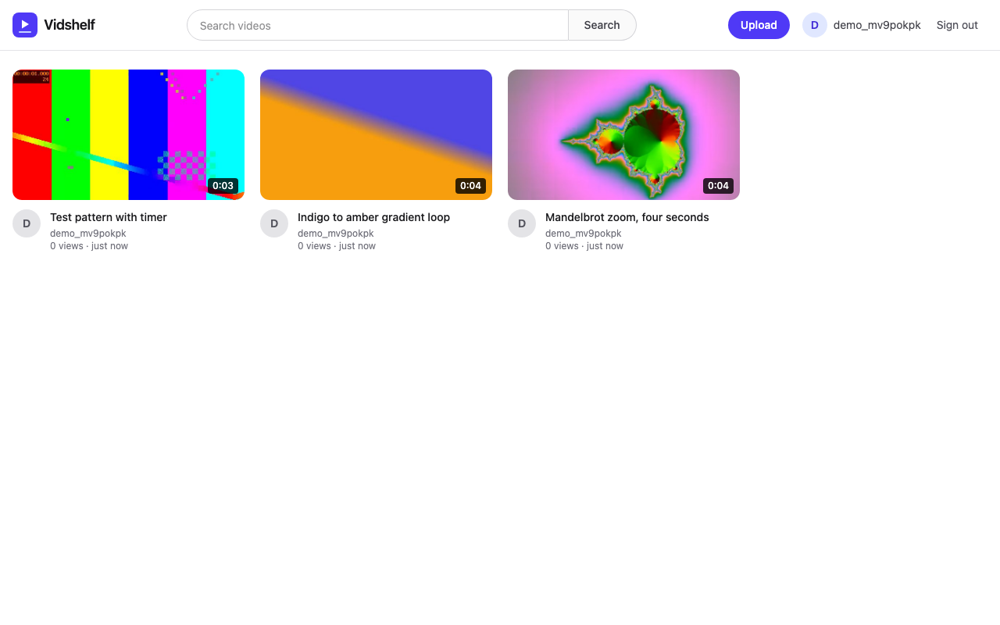
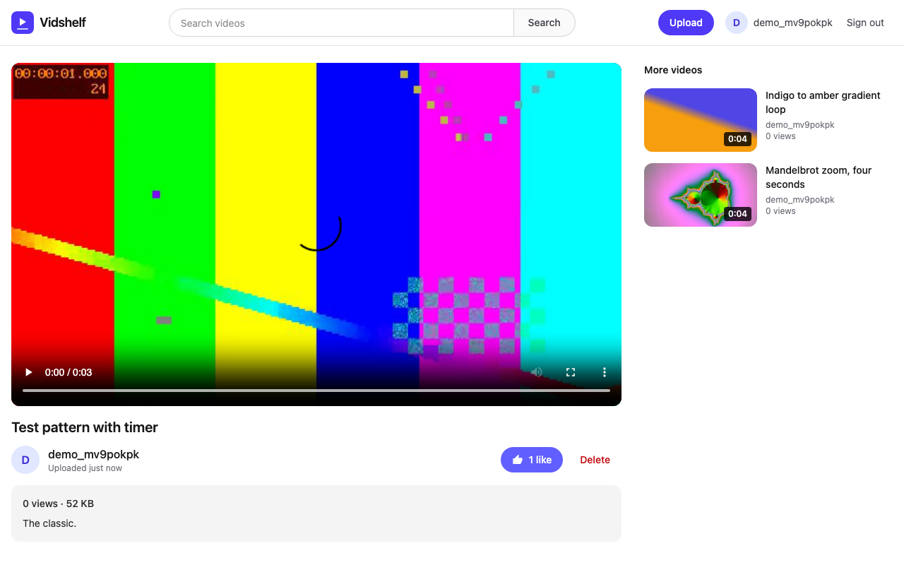
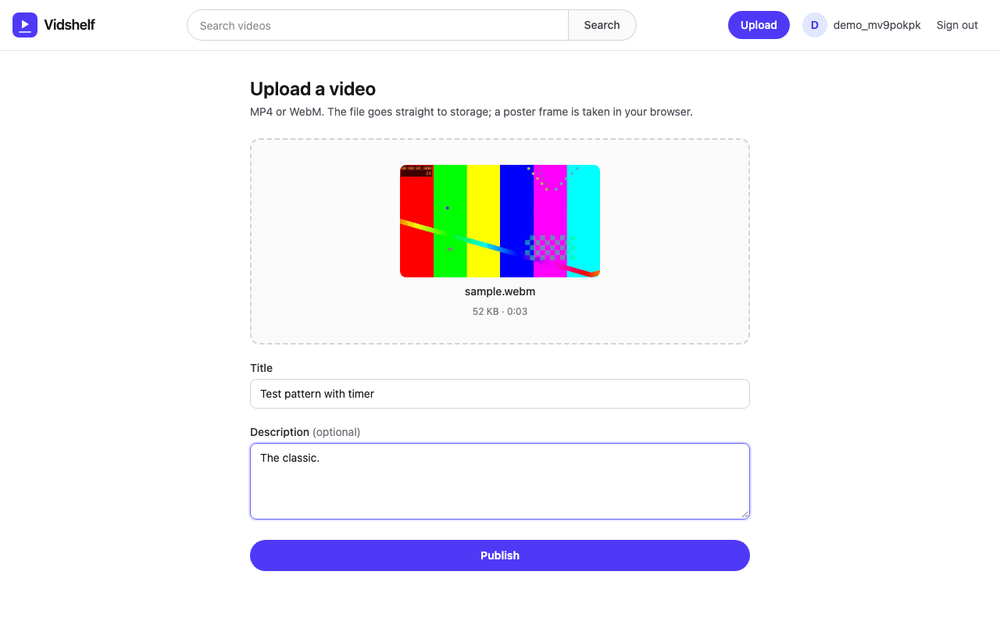
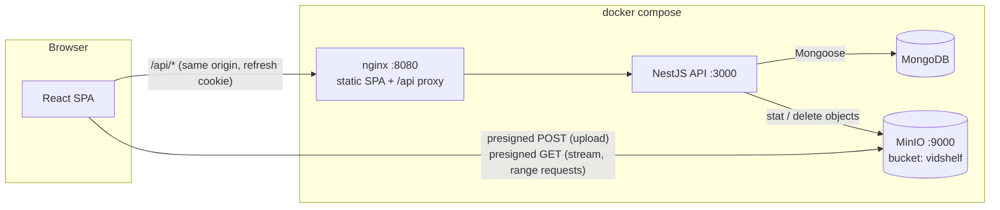
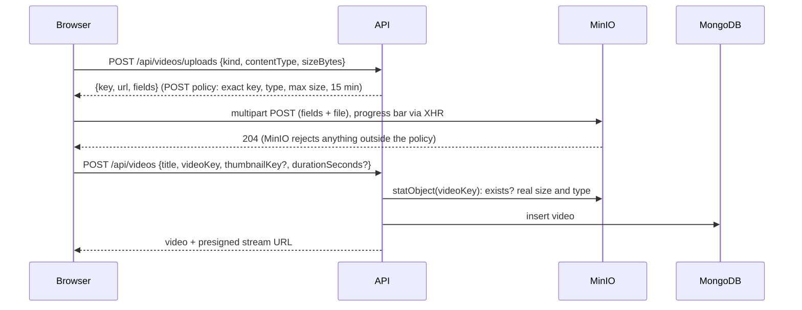

# Vidshelf

A small full-stack video sharing app. You can sign up, upload a video straight to object storage,
browse and search, watch it stream, and like it.

- **API:** NestJS 12, MongoDB (Mongoose 9), MinIO (S3-compatible) and Swagger. Access and refresh
  JWTs, where each refresh token can be used once and replaying a used one is detected.
- **Web:** React 19, React Router 8, Vite 8 and Tailwind CSS 4.
- **Ops:** a single `docker compose` file runs MongoDB, MinIO with a bucket-init step, the API, and
  the web app behind nginx.

I started this in 2025 as a learning project, and it stopped with the web app as a static mock. In
October 2026 I finished it with a deliberately small scope: every feature listed here is wired end
to end, and [What is not done](#what-is-not-done) lists what is missing.

## Status

| Check                                                      | How                                                                           | State           |
| ---------------------------------------------------------- | ----------------------------------------------------------------------------- | --------------- |
| Lint, typecheck, unit + HTTP-layer tests, production build | `npm run lint && npm run typecheck && npm test && npm run build` (also in CI) | Passing locally |
| API end-to-end tests (real MongoDB + MinIO)                | [Tests](#tests)                                                               | Passing locally |
| Browser smoke test (Playwright)                            | [Tests](#tests)                                                               | Passing locally |
| `docker compose up --build`                                | [Run it](#run-it)                                                             | Passing locally |

The last three need Docker. They ran on 2026-10-15 against this compose stack (OrbStack on an
Apple Silicon Mac): 17 API end-to-end tests and the browser smoke test passed. CI does not run them
yet. That first real run found a bug the mocked tests could not: the `ObjectId` references in the
Mongoose schemas were declared so that they became untyped (`Mixed`) paths, so refresh-token
rotation never matched its session. `apps/api/src/schemas.spec.ts` now guards against it.

## Screenshots

Taken by Playwright from the running compose stack, not mockups. To regenerate them:
`docker compose up --build -d && SCREENSHOTS=1 npx playwright test screenshots`.







## Architecture



Video bytes never pass through the API or nginx. The API decides who may write which object and
signs short-lived URLs. The browser then talks to MinIO directly.



### Design notes

- **Uploads use a presigned POST policy, not an API proxy.** A proxy would hold every upload in
  the Node process and double the traffic. A presigned PUT cannot cap the file size. A POST policy
  lets MinIO enforce the exact key, content type and size range, so the API only signs and then
  verifies with `statObject`. The size and type stored for a video come from storage, never from
  the client. Keys look like `videos/<userId>/<uuid>.<ext>`, and `POST /videos` rejects a key
  outside the caller's own prefix.
- **There are two MinIO clients.** S3 signatures cover the Host header. The API reaches MinIO as
  `minio:9000` inside compose, but the browser needs URLs for `localhost:9000`. One client does
  the real calls on the internal address. The second only signs for `MINIO_PUBLIC_URL`, and since
  its region is fixed, signing never opens a network connection.
- **Streaming uses a presigned GET URL** that is valid for one hour. `<video>` makes its own HTTP
  range requests to MinIO, so seeking works without any streaming code in the API.
- **Auth.** The access token is a 15-minute JWT that the web app keeps only in memory. The refresh
  token is a 7-day JWT in an `httpOnly`, `SameSite=Strict` cookie scoped to `/api/auth`.
  - Each sign-in starts a session: one MongoDB document that stores the SHA-256 hash of the only
    refresh token currently valid for it (never the token), a rotation counter and `revokedAt`.
  - A refresh succeeds only through one conditional update of that document: "this session is not
    revoked or expired and its current token is the one presented" → "store the replacement's
    hash". So each refresh token works once.
  - Presenting a token from an older generation of its session (one that was already used) is
    treated as theft: that session and every other active session of the user are revoked.
  - **Two-tab grace window.** Tabs share one cookie, so two tabs can refresh with the same token
    at once (the web app serialises refreshes with the Web Locks API, but not every client has
    it). The token the last rotation consumed is therefore accepted again for 10 seconds after
    that rotation, once, while the session is live: the answer is a new access token and no new
    cookie, because the winning request already set it. Outside that window, a second time, or
    any older token, it is reuse as above. The cost: a thief replaying a just-rotated token
    within those 10 seconds gets one access token (15 minutes) instead of triggering revocation.
  - **Sign-out** ends the session the cookie's token belongs to, identified by the token's
    signature, session id and generation (the current token or the one just replaced), not by
    looking up its hash. So it still works if a refresh replaced the token a moment earlier.
  - Revoking (reuse or sign-out) is also a single-document update, so it cannot be outrun by a
    refresh in flight at the same moment: that refresh either stored its replacement first (and
    the replacement is revoked with the session), or it finds the session revoked and fails
    without returning a token. `auth.service.spec.ts` interleaves the two to check this.
  - In the web app, signing out cancels any refresh in flight and ignores its response if it
    still arrives (an "auth epoch" counter), so a late refresh cannot sign the user back in.
  - Access tokens that were already issued stay valid until they expire (at most 15 minutes).
    Sessions started by a new sign-in after a revocation are not affected.
  - Every route requires a token unless it is marked `@Public()`. Public routes still read a
    valid token if one is sent, which is how `likedByMe` works for signed-in viewers.
  - `/api/auth/*` is rate limited per IP.
- **Likes are atomic and idempotent.** Each like is one single-document update with a filter
  (`likedBy: {$ne: me}` with `$addToSet` and `$inc`), so double clicks and retries cannot skew the
  count.
- **Validation and errors.** DTOs use `class-validator`, unknown fields are rejected, and ids are
  checked before they reach a query. Passwords are limited to 72 bytes of UTF-8, not 72
  characters, because bcrypt ignores everything after byte 72; the bcrypt cost is 12 by default
  and the API refuses to start with less than 10. MongoDB duplicate keys map to 409. The environment is
  validated once at startup, and the API refuses to start with a list of everything that is wrong.
- **Thumbnails and duration are captured in the browser.** The upload page draws a frame onto a
  canvas, so the server needs no ffmpeg.

## API

Swagger UI is served at `/api/docs` (http://localhost:3000/api/docs when running).

| Method       | Path                                 | Auth              | Purpose                                                                |
| ------------ | ------------------------------------ | ----------------- | ---------------------------------------------------------------------- |
| POST         | `/api/auth/register`                 | public            | Create an account. Returns an access token and sets the refresh cookie |
| POST         | `/api/auth/login`                    | public            | Sign in                                                                |
| POST         | `/api/auth/refresh`                  | refresh cookie    | Rotate the refresh token. Returns a new access token                   |
| POST         | `/api/auth/logout`                   | refresh cookie    | Revoke the current refresh token and clear the cookie                  |
| GET          | `/api/auth/me`                       | bearer            | The signed-in user                                                     |
| POST         | `/api/videos/uploads`                | bearer            | Presigned POST policy for a video or thumbnail                         |
| POST         | `/api/videos`                        | bearer            | Publish an uploaded video                                              |
| GET          | `/api/videos?q=&owner=&page=&limit=` | public            | List newest first, or full-text search                                 |
| GET          | `/api/videos/:id`                    | public            | One video with a presigned stream URL and `likedByMe`                  |
| PATCH        | `/api/videos/:id`                    | bearer (uploader) | Edit title or description                                              |
| DELETE       | `/api/videos/:id`                    | bearer (uploader) | Delete the record and its stored files                                 |
| PUT / DELETE | `/api/videos/:id/like`               | bearer            | Like or unlike (idempotent)                                            |
| POST         | `/api/videos/:id/views`              | public            | Count a play                                                           |
| GET          | `/api/health`                        | public            | Liveness and MongoDB connectivity                                      |

## Run it

Requirements: Docker with Compose v2 for the full stack. For local development you also need
Node.js 24 LTS (`.nvmrc`).

### Everything in Docker

```bash
scripts/gen-env.sh        # 1. writes .env with random JWT secrets and MinIO credentials
docker compose up --build # 2. builds and starts everything
```

Open http://localhost:8080. Other addresses:

- API and Swagger: http://localhost:3000/api/docs
- MinIO console: http://localhost:9001 (user `MINIO_ACCESS_KEY`, password `MINIO_SECRET_KEY`
  from `.env`)

There are no built-in secrets. Without `.env` (or the same variables in the shell), compose stops
with "run scripts/gen-env.sh to create .env". `.env` is git-ignored and created with mode 600; the
script will not overwrite it unless you pass `--force`. All ports bind to `127.0.0.1`. To stop and
delete the data: `docker compose down -v`.

MinIO runs as `pgsty/minio`, a community-maintained build, pinned in `docker-compose.yml` by tag
and image digest. Upstream MinIO stopped publishing community container images in late 2025. The API only speaks S3 through the `minio` SDK, so any
S3-compatible store works if you change `MINIO_*`.

### Local development (hot reload)

```bash
scripts/gen-env.sh                            # skip if .env already exists
docker compose up -d mongo minio minio-init   # just the data services
npm install
npm run dev                                   # API on :3000, web on http://localhost:5173
```

Vite proxies `/api` to the API, so the browser sees one origin, as it does behind nginx.

## Tests

```bash
npm test             # API unit + HTTP-layer tests (Jest), web unit tests (Vitest); no services needed
npm run test:e2e     # API end-to-end with supertest; needs .env and: docker compose up -d mongo minio minio-init
npm run test:browser # Playwright smoke; needs the full stack: docker compose up --build -d
```

The browser test needs Chromium installed once with `npx playwright install chromium`.

- **Unit tests:**
  - `auth.service.spec.ts`: registration (including the 72-byte limit), login, refresh rotation,
    reuse detection, expiry, forged tokens and logout, run against an in-memory session store.
    Further tests cover the two-tab grace window and sign-out racing a refresh. The "refresh
    racing reuse detection" tests pause a legitimate refresh while its replacement token is being
    minted, and again right before it is stored, run the reuse detection in that gap, and check
    that the replacement never works.
  - `videos.service.spec.ts`: upload policy limits, key ownership, publish checks, search and
    sort, ownership on edit and delete, atomic likes, views.
  - `env.spec.ts`: environment validation, including the bcrypt cost floor.
  - `schemas.spec.ts`: user references in the Mongoose schemas are real `ObjectId` paths.
  - `apps/web/src/lib/api.test.ts` (Vitest): a refresh still in flight at sign-out, or at a new
    sign-in, is cancelled and its late response is ignored.
- **HTTP layer** (`http.spec.ts`): the real controllers, global guard, validation pipe, refresh
  cookie and Swagger document, with mocked services.
- **End to end** (`apps/api/test/app.e2e-spec.ts`): the whole API against real MongoDB and MinIO,
  using a separate `vidshelf_e2e` database and `vidshelf-e2e` bucket. It covers:
  - the cookie flags;
  - rotation, the one-time two-tab grace answer, and family revocation;
  - MinIO rejecting a tampered upload;
  - range requests on the stream URL;
  - likes, views and permissions.
- **Browser** (`e2e/smoke.spec.ts`): signs up, uploads `e2e/fixtures/sample.webm`, checks the
  video actually plays and the view count updates, likes it, and finds it through search.

CI (`.github/workflows/ci.yml`) runs `format:check`, lint, typecheck, `npm test` and the build on
Node 24. The Docker-based suites are not in CI yet.

## Project layout

```
apps/api      NestJS API (auth/, videos/, minio/, users/, common/, config/)
apps/web      React SPA (pages/, components/, lib/) + nginx.conf for the container
e2e           Playwright smoke test, screenshot script and video fixtures
scripts      gen-env.sh (writes .env with random secrets)
docker-compose.yml, .env.example, .github/workflows/ci.yml
```

## What is not done

- **No transcoding or adaptive streaming.** The original MP4 or WebM file is served as uploaded.
  A file whose codec the browser cannot play will not play.
- **No server-side thumbnails.** If the browser cannot decode a frame, the card shows a placeholder.
- **Views are not de-duplicated.** Each first play on a page load counts once.
- **The `likedBy` array lives on the video document.** That keeps likes atomic without
  transactions, but it would not scale to millions of likes per video. A separate collection would.
- **No user profiles, avatars, comments, subscriptions, playlists or watch history.** There is also
  no email verification, password reset or account deletion.
- **Orphaned uploads stay in the bucket.** That covers uploaded but never published files, and
  files whose delete failed. A bucket lifecycle rule or a sweeper job would clean them up.
- **Search is MongoDB `$text`** (word stems, not prefixes or typos).
- **Single region, no CDN, no HTTPS termination.** Set `COOKIE_SECURE=true` behind HTTPS.

## License

[MIT](LICENSE)
